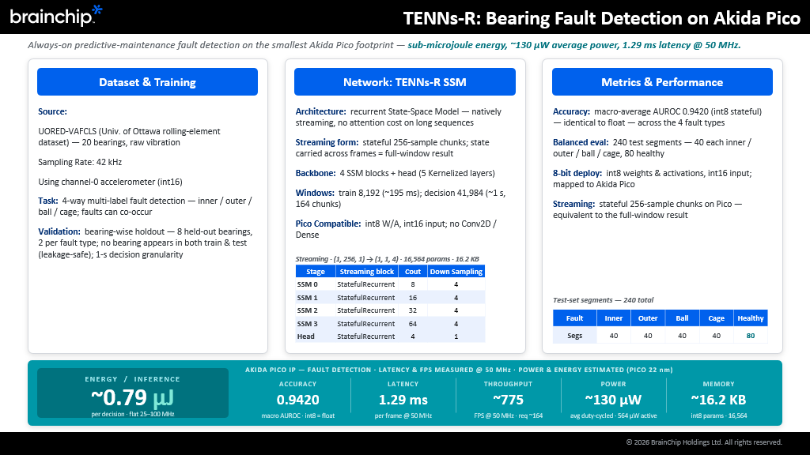

# Akida Pico — Model Development Guide

BrainChip Holdings Ltd. · November 2026

## Purpose and scope

This guide takes an ML engineer from a trained 1-D sensor model to a quantized network running on Akida Pico, using the MetaTF toolchain (`akida`, `cnn2snn`, `quantizeml`, `akida_models`).

- **Audience:** ML engineers working with Akida Pico. It assumes Keras and TensorFlow experience and no prior Akida knowledge.
- **Covers:** what Pico runs, the recurrent TENN model family, the two zoo models, design rules and hardware limits, the build-to-deploy workflow, validation, on-device measurement, and what to expect for each target application.
- **Does not cover:** how to obtain trained weights. Training from scratch and fine-tuning are in the companion *Model Training & Fine-Tuning Guide*.
- **Hardware used for examples:** the Akida Pico FPGA cloud platform (one Pico node with one `TNP_R` neural processor), reached through JupyterLab.

Two models in the model zoo are worked through end to end: 12-class keyword spotting (`tenn_recurrent_sc12`) and 4-label bearing fault classification (`tenn_recurrent_uored`). Wake word, health monitoring and anomaly detection are covered as design guidance only; the Application playbooks section says what to expect for each.

## Akida Pico at a glance

Akida Pico is an ultra-low-power, event-based neural IP for always-on 1-D sensing (audio, vibration, biosignals). It runs one family of networks, recurrent TENNs, on a single neural processor of type `TNP_R`.

**What shapes a Pico model**

- **Raw samples in.** The reference models read int16 samples directly. There is no FFT, MFCC or spectrogram front end.
- **Streaming.** The network consumes a small chunk (256 samples in both zoo models) and carries state between chunks, so memory and compute stay constant however long the stream runs.
- **8-bit.** The software pipeline quantizes weights and activations to 8 bits; the input is int16.
- **On-chip.** The whole model must fit in Pico's on-chip memory. The mapped summary reports the model's size.
- **One toolchain.** MetaTF is the path from a Keras model to Pico. The FPGA cloud runs `akida` 2.19.x and exposes the device as `akida.devices()[0]` (`IpVersion.pico`).

**Target applications**

| Application | Input | Output | Model status |
| --- | --- | --- | --- |
| Keyword spotting | 16-bit PCM audio, up to 20 kHz | Keyword index | `tenn_recurrent_sc12` in the model zoo; 12 classes |
| Bearing fault classification | 42 kHz accelerometer, int16 | 4 independent fault labels | `tenn_recurrent_uored` in the model zoo |
| 1-D anomaly detection | 16–24-bit integer stream | Anomaly score and flag | No packaged model in the zoo; design guidance only |
| Wake word | Continuous 16-bit audio | Interrupt to host | No packaged model in the zoo; design guidance only |
| Health monitoring | Multi-channel biosignal | Continuous estimate | No packaged model in the zoo; design guidance only |

**Reference result.** At 50 MHz, the 12-class KWS model runs in real time at about 64 µW duty-cycled (about 1 µJ per inference) with roughly 95% accuracy on Speech Commands. The average is made up of about 50 µW of active power and 14 µW of leakage. The power figure is an estimate from Pico hardware characterization (22 nm, 5% switching activity), not a measurement on the FPGA.

## Recurrent TENN concepts

A Pico model exists in two forms with the same weights: a **kernelized** form you train on a GPU, and a **stateful** form that streams on the device. The workflow is about moving safely from the first to the second.

|  | Kernelized (training) | Stateful (deployment) |
| --- | --- | --- |
| Input | A whole window, e.g. `(batch, 16384, 1)` | One chunk, `(1, 256, 1)` |
| Output | One prediction per window after global average pooling | One output step per chunk |
| Core layer | `Kernelized`: temporal convolution whose kernel is generated from state-space parameters `A`, `B`, `C`, `log_dt` | `StatefulRecurrent` with a complex diagonal state, plus two `StatefulProjection` layers |
| Memory | Grows with window length | Constant: the state is carried between chunks |
| Trainable | Yes | No. Stateful training is not supported |

**The kernelized block.** `kernelized_block` stacks `Kernelized` → `Stride` (temporal subsampling) → `BatchNormalization` → ReLU. The hidden size of each layer is `num_coeffs × repeat`; the zoo models use `num_coeffs = 32` with the default `repeat = 2`.

**Converting to stateful.** `convert_to_stateful(model, timesteps=256)` rewrites each `Kernelized` layer into four steps:

1. `StatefulProjection` applying the discretized input matrix `B̂` (no bias).
2. `StatefulRecurrent` applying the discretized state matrix `Â`, kept as real and imaginary parts. Discretization is zero-order hold.
3. `ExtractToken`, which keeps the real part of the state.
4. `StatefulProjection` applying `C`, with the layer's temporal subsampling folded in.

`Stride`, `SpatialDropout1D` and the final `GlobalAveragePooling1D` are removed, and batch norm is folded into the weights. On the device the pooling you removed becomes your job: average or smooth the per-chunk outputs yourself (see Deploying and measuring on Pico).

**Chunk size is a design constant.** The chunk size equals the product of all layer subsampling factors, so each chunk yields exactly one output step. Both zoo models subsample by 256 in total (SC12: 4·4·2·2·2·2; UORED: 4·4·4·4). At 16 kHz that is a decision every 16 ms; at 42 kHz, every 6.1 ms.

**Equivalent, not identical, in practice.** The two forms compute the same function for the same input window. Scores can still differ on real data, because the stateful model keeps context across chunk boundaries while the kernelized model sees only its window.

## The model zoo

Two Pico models ship in `akida_models` (1.14.x): a 12-class keyword spotter and a 4-label bearing fault classifier. Both are raw-input recurrent TENNs and both map to the Pico as a single hardware sequence on one `TNP_R`.

|  | `tenn_recurrent_sc12` | `tenn_recurrent_uored` |
| --- | --- | --- |
| Task | Keyword spotting, 12 classes (10 keywords, silence, unknown) | Bearing fault classification, 4 independent labels (inner race, outer race, ball, cage) |
| Dataset | Speech Commands v0.02 via TensorFlow Datasets | UORED-VAFCLS, 42 kHz accelerometer, bearing-wise split |
| Training input | `(16384, 1)` int16, about 1 s at 16 kHz | `(8192, 1)` int16, about 195 ms at 42 kHz |
| Kernelized blocks | 6, plus a classification head | 4, plus a classification head |
| Channels | 8, 16, 32, 64, 96, 128 | 8, 16, 32, 64 |
| Subsampling per block | 4, 4, 2, 2, 2, 2 (×256) | 4, 4, 4, 4 (×256) |
| Head | 12 logits, no batch norm or ReLU | 4 logits, no batch norm or ReLU |
| Loss | Sparse categorical cross-entropy (logits) | Binary cross-entropy (logits) |
| Streaming chunk | 256 samples (16 ms) | 256 samples (6.1 ms) |

Both start with a `Rescaling` layer that divides the int16 input by 2^15, so the network sees values in [−1, 1).

**Quality.** Training is not fully reproducible: keyword spotting accuracy varies by about 1 to 1.5 points between runs, so the table shows a typical run and the best of several runs.

| Stage | SC12 top-1, typical run | SC12 top-1, best of several runs |
| --- | --- | --- |
| Float, kernelized | 94.98% | 96.22% |
| Float, stateful | 95.01% | 96.24% |
| Quantized, 8-bit stateful | 94.01% | 95.93% |
| Akida (mapped) | 94.01% | 95.91% |

SC12 is scored per 1-second clip by averaging the 64 per-chunk logits.

For UORED, the mapped int8 model reaches a macro AUROC of about 0.94 (0.942) on held-out bearings, and the float, quantized and mapped scores are within about 0.01 of each other. It is scored per roughly 1-second segment (41,984 samples, 164 chunks), on a test set of 240 segments from 8 held-out bearings: 40 each of inner race, outer race, ball and cage faults, and 80 healthy. The model has 16,564 int8 parameters (16.2 KB).

**Getting a model out of the zoo.**

```python
import akida, cnn2snn, akida_models

# Quantized stateful model, ready to convert (default)
model_q = akida_models.tenn_recurrent_sc12_pretrained()

# Float stateful model, useful as a reference
model_f = akida_models.tenn_recurrent_sc12_pretrained(quantized=False)

# Convert and map: software model of Pico, or the FPGA device
model_ak = cnn2snn.convert(model_q)
model_ak.map(akida.PicoIP())          # or: model_ak.map(akida.devices()[0])
model_ak.summary()                    # expect 1 sequence, 1 x TNP_R
```

The `_pretrained()` helpers return stateful models. To start training, build the kernelized model with `akida_models.tenn_recurrent_sc12()` (or `tenn_recurrent_uored()`) and load kernelized weights, such as the `.h5` files in the `bc_cloud_pico` examples. The same pair exists for UORED: `tenn_recurrent_uored_pretrained()` and `tenn_recurrent_uored()`.

## Designing or changing a model

You can change channels, depth, subsampling, state size and input shape, but the Pico mapping step rejects anything outside the hardware limits. Treat the mapping error as the final authority and check it early.

**What you can tune**

| Knob | Zoo value | Effect |
| --- | --- | --- |
| Blocks and channels | 5 to 7 blocks; 8 up to 128 channels | Capacity, memory and compute |
| `num_coeffs` × `repeat` | 32 × 2 = 64 states per layer | Memory of each layer; 64 is the size validated on hardware |
| Subsampling per block | 4, 4, 2, 2, 2, 2 or 4, 4, 4, 4 | Where time is reduced; sets the chunk size |
| Chunk size | 256 samples | Decision rate and latency; equals total subsampling |
| Input scaling | `Rescaling(1/2^15)` | Matters most for autoencoders, where MSE depends on the absolute scale |
| Input channels | 1 | Multi-channel input is allowed within the buffer rule below |

**Hardware and mapping limits**

| Limit | Value | Notes |
| --- | --- | --- |
| Subsampling in one layer | At most 4 | Checked when you map. Larger values fail with *Subsample ratio exceeds max limit of 4 for TNP-R* |
| Chunk size | Power of 2 | Checked when you map |
| First-layer input row | The packed row must fill a power-of-2 number of 32-bit words, at most 128. Words = bit_ceil(ceil(channels × input bits / 32)) | Checked when you map. 3 channels fit in 1 word at 8-bit and 2 at 16-bit. Timesteps do not enter this check |
| Weights and activations | 8-bit signed | Matches the software pipeline |
| Input / output channels per layer | Up to 256; only powers of 2 verified | Hardware design limit |
| States per layer | 64 and 256 validated | Hardware design limit |
| Layers | Up to 8 | Hardware design limit |
| Layer structure | A plain chain of stateful recurrent layers; no skip connections | The stateful conversion accepts single-input kernelized layers only |
| Output without ReLU | Last layer only | Hardware design limit |

These are the limits as understood when this guide was written. The mapping error and the current Pico documentation take precedence if they differ.

**Design rules that follow**

1. Choose the chunk size first, as a power of 2, then split it across layers with at most 4 per layer (256 = 4·4·4·4).
2. Keep the hidden size at 64 states per layer unless you have a reason and a hardware check.
3. Keep the model a plain feed-forward stack of kernelized blocks. Skip connections do not map.
4. After every architecture change, build the kernelized model, convert to stateful, quantize and run `map()` on `akida.PicoIP()` before spending GPU hours on training. Random calibration data is enough for a mapping check.
5. Expect one hardware sequence on one `TNP_R`. More than one sequence, or software-executed layers in the summary, means something did not map.

Upsampling and stand-alone dense layers are outside the model structure this guide describes. Check the current MetaTF hardware-constraints documentation before relying on them.

## End-to-end workflow

Five steps take a trained kernelized model to inference on Pico. The code below is the SC12 path from the `bc_cloud_pico` notebooks; the UORED path is identical apart from the model, the calibration file and the metric.

**1. Load the kernelized model and weights**

```python
import akida_models
model = akida_models.tenn_recurrent_sc12()          # (batch, 16384, 1) int16 -> 12 logits
model.load_weights("weights/tenn_recurrent_sc12.h5")
```

**2. Convert to the stateful form.** The chunk size must match the total subsampling and the hop you will stream at.

```python
from akida_models.tenn_recurrent.convert_recurrent import convert_to_stateful
model_recurrent = convert_to_stateful(model, 256)   # input (1, 256, 1), output (1, 1, 12)
```

For anomaly detection, `convert_to_stateful(model, 256, threshold=...)` also appends a `PicoPostProcessing` layer that compares the input with the reconstruction against a threshold.

**3. Quantize to 8-bit weights and activations with int16 input.** Calibration samples are a `.npz` file with a `data` array of int16 segments from the training distribution. The SC12 sample pack is `(100, 1024, 1)`; the UORED pack is `(256, 8192, 1)`.

```python
import numpy as np, quantizeml
from quantizeml.models import QuantizationParams

samples = np.load("calibration/sc10_batch100_1024samples.npz")["data"]
model_quantized = quantizeml.models.quantize(
    model_recurrent,
    qparams=QuantizationParams(activation_bits=8, weight_bits=8, input_dtype="int16"),
    batch_size=100, epochs=1, samples=samples)
```

The command-line equivalent is `quantizeml quantize -w 8 -a 8 -id int16` on the saved stateful model; run `quantizeml quantize --help` for the calibration options.

**4. Convert to Akida and map to the device**

```python
import akida, cnn2snn
model_akida = cnn2snn.convert(model_quantized)
device = akida.devices()[0]             # the Pico FPGA; use akida.PicoIP() without hardware
model_akida.map(device)                  # add hw_only=True to fail if any layer stays in software
model_akida.summary()                    # expect: 1 sequence, 1 x TNP_R, input [1, 256, 1]
```

**5. Run inference one chunk at a time.** The Akida model takes `(batch, 1, 256, 1)` int16.

```python
frame = chunk.reshape(1, 1, 256, 1).astype(np.int16)
logits = model_akida.forward(frame)      # state is carried between calls
```

If you need a clean start, for example between independent clips, reset the state: call `model_akida.reset_states()` where available, or rebuild the model with `akida.Model(model_akida.layers)` as the training scripts do.

**Environment.** The cloud host has the Pico attached and conda available. Install with `pip install -r requirements.txt` from the `bc_cloud_pico` repository, which pins `akida ~= 2.19.2`, `cnn2snn ~= 2.19.2` and `akida_models ~= 1.14.1`. Confirm the device with `akida devices` before you start.

## Validating quality at every stage

Score the same held-out data at four stages, in order, and stop at the first stage where the number drops more than you expect. Each stage isolates one transformation.

| Stage | What it checks | What to expect |
| --- | --- | --- |
| 1. Float kernelized | The trained model on whole windows | Your training result |
| 2. Float stateful | The `convert_to_stateful` rewrite, chunk by chunk | Within about 1 point of stage 1. It can be higher, because state spans chunk boundaries |
| 3. Quantized stateful | 8-bit weights and activations, int16 input | A drop of about 0.3 to 1 point (SC12: 95.01% to 94.01%, and 96.24% to 95.93%). For UORED, macro AUROC moves by less than 0.01 |
| 4. Akida, mapped | The converted model on the Pico device or its software model | Within about 0.3 point of stage 3 (SC12: 94.01% and 94.01%) |

A large gap at stage 3 points to calibration data that does not match deployment data. A large gap at stage 4 is a conversion or mapping problem; please report it to BrainChip.

**Score the way the model is deployed**

- **Aggregate per segment from raw logits.** For SC12, average the 64 per-chunk logits of a clip, then take the argmax. Do not average softmax probabilities. For UORED, average the per-chunk logits, apply a sigmoid and threshold at 0.5.
- **Match the metric to the task.** SC12: top-1 accuracy, macro F1 and weighted F1. UORED: macro and micro AUROC, AUPRC, F1, exact match, Hamming score and per-fault AUROC.
- **Split by recording source.** UORED is split by bearing so no bearing appears in both train and test. Window-level random splits leak and inflate results.
- **Reset state between independent segments** when scoring, so one clip cannot influence the next. In a continuous deployment you do not reset, so also run a stream test that concatenates segments and checks that predictions settle within a few chunks after each boundary.
- **Reset on the training window for autoencoders.** Evaluating an autoencoder on Akida without resetting the state every training window can make performance collapse.
- **Report variance.** Repeat training with different seeds before comparing two designs (see the Training & Fine-Tuning Guide).

**Command-line evaluation**

```bash
tenn_sc12_train eval -m tenn_recurrent_sc12_stateful_i8_w8_a8.h5 -d <data_dir> -ak
```

Akida evaluation runs at batch size 1 and is slow; the scripts force this and run on the CPU. The float stateful evaluation can use a large batch.

**Pick a decision window.** The fault-detection example sweeps accuracy against the number of chunks accumulated before deciding. Use the same sweep for your application: it turns a latency requirement into a window length.

## Deploying and measuring on Pico

Once mapped, a model is real time if the device finishes one chunk before the next arrives. Measure the cycles per chunk once, then derive latency, throughput and power for any clock.

**Real-time budget.** Required frame rate = sample rate ÷ chunk size.

| Application | Sample rate | Chunk | Required rate | Time per chunk |
| --- | --- | --- | --- | --- |
| Keyword spotting | 16 kHz | 256 | 62.5 chunks/s | 16 ms |
| Bearing fault | 42 kHz | 256 | about 164 chunks/s | about 6.1 ms |

**Measure cycles per chunk.** Run a warm-up pass, then a timed pass over a batch of synthetic chunks; timing does not depend on the data values. The device reports total clock cycles in `metrics['inference_clk']`.

```python
batch = 1000
frame = np.random.rand(batch, 1, 256, 1).astype(np.int16)
_ = model_akida.forward(frame)                    # warm-up
_ = model_akida.forward(frame)                    # measured
cycles = model_akida.metrics["inference_clk"] / batch
hw_clock = 50_000_000                             # FPGA reference clock, 25 to 100 MHz in the demos
fps = hw_clock / cycles
latency_ms = 1000 / fps
```

The KWS notebook uses a reference of about 72,500 cycles per chunk, which is 1.45 ms and about 690 chunks per second at 50 MHz, about 11 times the 62.5 needed.

**Duty-cycle power model.** The device is active only while processing a chunk and leaks otherwise. With `t_inf` the latency and `T_buf` the chunk period:

```latex
P_{active} = 550\,\mu W \cdot \frac{f}{50\,\mathrm{MHz}} + 14\,\mu W

P_{avg} = P_{active} \cdot \frac{t_{inf}}{T_{buf}} + 14\,\mu W \cdot \left(1 - \frac{t_{inf}}{T_{buf}}\right)
```

For KWS this gives about 64 µW average and about 1 µJ per inference, and the average stays almost constant from 25 to 100 MHz: a lower clock lowers active power but keeps the device active longer. Running faster than real time raises average power because the device spends more time active.

These constants (550 µW at 50 MHz, 14 µW leakage) come from Pico hardware characterization at 22 nm and 5% switching activity. Power and energy are therefore estimates, not FPGA measurements. Latency and throughput are measured on the FPGA.

**Cross-check on the fault-detection model.** The same model reproduces the figures BrainChip reports for the fault-detection model. At 50 MHz the mapped model takes 1.29 ms per 256-sample chunk (about 64,500 cycles), which is about 775 chunks per second against the 164 needed at 42 kHz. The chunk period is 6.1 ms, so the duty cycle is 1.29 ÷ 6.1 = 21%, and the average power is 564 µW × 0.21 + 14 µW × 0.79 ≈ 130 µW, or about 0.79 µJ per decision.



*BrainChip TENNs-R bearing fault detection summary. Latency and throughput are measured at 50 MHz; power and energy are estimated for Pico at 22 nm.*

**Streaming inference.** In deployment you feed chunks continuously and never buffer the whole clip.

1. Zero-pad the stream to a multiple of the chunk size.
2. Call `forward` once per chunk and collect the per-chunk logits.
3. Smooth with a sliding mean over the logits, then apply softmax or sigmoid.
4. Apply your own trigger logic (threshold, hold time, consecutive hits) on the smoothed output.

The pooling layer you dropped during stateful conversion is exactly this step. The window is an application choice: SC12 scoring averages all 64 chunks of a second, while a live system usually fires earlier on a shorter window.

**System view.** Paired with an ultra-low-power MCU, Pico sits always on at the sensor and the host SoC stays asleep until Pico raises a single wake event.

## Application playbooks

Two applications have runnable models in the zoo today. For the other three, this section gives design guidance so you can plan; it does not describe packaged models.

| Application | Start from | Change for your case | Status |
| --- | --- | --- | --- |
| Keyword spotting | `tenn_recurrent_sc12` | Class count and labels; retrain or fine-tune on your keywords and noise | In the zoo; 94 to 96% on SC12 |
| Bearing fault classification | `tenn_recurrent_uored` | Number of labels, input scaling, sample rate; keep bearing-wise splits | In the zoo |
| 1-D anomaly detection | Autoencoder of kernelized blocks | Bottleneck depth, window length, threshold | Design guidance only |
| Wake word | KWS architecture with a small head | One or few phrases; false-accept control | Design guidance only |
| Health monitoring | Regression head on the same blocks | Output type and scaling | Design guidance only |

**Keyword spotting.** Swap `num_classes` in `tenn_recurrent_sc12()` and retrain; everything downstream is unchanged. Changing the keyword set means retraining off-device and reloading the whole model onto Pico. Class balance matters: sampling an equal number of examples per class each epoch cost about 2 points when removed in one SC12 comparison, which is about the size of run-to-run noise, so confirm it on your data.

**Bearing fault classification.** Output is multi-label, so use sigmoid and binary cross-entropy, not softmax. The reference preprocessing normalizes each recording to its own peak and scales it to int16, and training adds a random gain augmentation. A deployed sensor never knows a recording's peak, so for your own data choose one global scale and keep it identical in training, calibration and deployment. Expect about 0.94 macro AUROC on held-out bearings.

**1-D anomaly detection.** The approach is an autoencoder: reconstruct the input and flag large reconstruction error. Train one general model on normal data only, use a temporal bottleneck and long input windows so the state-space memory is used, and set the threshold on normal validation data. `convert_to_stateful(..., threshold=...)` appends a distance-and-threshold post-processing layer. The decoder side may need upsampling, so check support for your design before committing to it. The Training & Fine-Tuning Guide has more.

**Wake word.** Wake word detection needs continuous operation without waking the host on every inference, and very few false accepts. A KWS-style network with a two-class or few-class head is a natural starting point; you would need to train and validate it against your own false-accept and false-reject requirements.

**Health monitoring.** The target is a continuous regression estimate. This needs a regression head and output scaling rather than logits. Plan for any regression post-processing to be handled on the host unless you have confirmed hardware support.

## Troubleshooting and common pitfalls

Most problems fall at one of three points: the mapping step, the first quantized evaluation, or run-to-run training variance.

| Symptom | Likely cause | What to do |
| --- | --- | --- |
| `Cannot map layer ... Subsample ratio exceeds max limit of 4 for TNP-R` | A layer subsamples by more than 4 | Spread the reduction over more layers, for example 8 as 4 then 2 |
| Input-size or input-channel error on the first layer | The packed input row is not a power-of-2 number of 32-bit words, or exceeds 128 words | Compute bit_ceil(ceil(channels × bits / 32)); the check does not involve timesteps |
| Summary shows more than one sequence, or layers in software | Part of the model did not map | Re-run `map(device, hw_only=True)` to get the error for the offending layer |
| Quantized accuracy far below stateful float | Calibration data does not match deployment data, or the random-data fallback was used | Calibrate with real int16 segments from the training distribution |
| Quantized output tracks the input at first, then flat-lines | Calibration scale, package versions or state handling | Check versions, calibration scale and state resets; report it if it persists |
| Akida accuracy collapses on a long stream | State was never reset where the model expects it (autoencoders: every training window) | Reset at the window length used in training |
| Accuracy differs by 1 to 1.5 points between identical runs | Training is not fully reproducible | Run several seeds and compare means; keep the seed of any model you ship |
| Training uses unexpected model code | An older `akida_models` earlier on the path | Start from a clean environment; print `akida_models.__file__` |
| Streaming predictions wrong just after a segment boundary | State from the previous segment is still settling | Smooth over a few chunks; do not score the first chunks of a segment |
| Stateful results differ from the notebook | Chunk size does not match the converted model | Convert and stream with the same chunk size, here 256 |
| First SC12 run is slow, or fails on audio | TFDS downloads about 2 GB once; `ffmpeg` is missing | Install `ffmpeg`; later runs use the cache |
| `akida.devices()` is empty or the board is busy | The FPGA is not visible or another session holds it | Run `akida devices`; wait for a free device, or map to `akida.PicoIP()` |

**Habits that prevent most of these**

- Run convert, quantize and map on every architecture change before training.
- Score with raw-logit averaging, not averaged probabilities.
- Compare designs on several seeds, never on one run.
- Keep float, stateful, quantized and Akida scores side by side in one table.

## Notes and limits

- **Estimates.** Power and energy figures are estimates from hardware characterization. Latency and throughput are measured on the FPGA at 50 MHz. Results on silicon depend on process, voltage, temperature and libraries.
- **Accuracy.** Published accuracy figures are for the datasets named above. They do not transfer to other data; evaluate on your own.
- **Hardware limits.** The limits table reflects the design as understood when this guide was written. The mapping error and the current Pico documentation take precedence.
- **Versions.** Commands and options were written for `akida` 2.19.x and `akida_models` 1.14.x.

## References

- [MetaTF documentation](https://doc.brainchipinc.com/index.html): API reference and hardware constraints.
- [bc_cloud_pico](https://github.com/Brainchip-Inc/bc_cloud_pico): runnable keyword spotting and bearing fault detection notebooks for the Akida Pico FPGA cloud platform.
- [`akida_models` on PyPI](https://pypi.org/project/akida-models/): model definitions, stateful conversion and training scripts.
- Warden, P. (2018). *Speech Commands: A Dataset for Limited-Vocabulary Speech Recognition* (Speech Commands v0.02, CC BY 4.0).
- UORED-VAFCLS: University of Ottawa rolling-element bearing dataset. Check the dataset's licence and citation requirements before use.

© 2026 BrainChip Holdings Ltd. All rights reserved.
